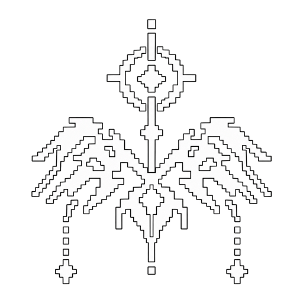

<p align="center">
  
</p>

# CASCADE

Quality-of-life mod for CICADAMATA" (full game): input fixes, HUD customization, and a ghost
theater for recording, sharing and studying runs.

Runs as a GDPatch mod. Nothing in the game's files is modified; changes are applied in memory
each time the game starts. Scores, PBs and leaderboards are never touched.

Latest release: https://github.com/ocucor/CASCADE/releases/latest

## Install

1. Install GDPatch (https://github.com/GDPatch/GDPatch): put `gdpatch_loader.dll` next to
   `CICADAMATA.exe` and rename it to <code title="Windows looks for a game's DLLs in the game's own folder before System32. The game imports winmm.dll at startup, so the loader takes that name, gets loaded in its place and forwards the real winmm calls.">winmm.dll</code>.
2. Copy the `qol` folder into the game's `GDPatch\mods\` folder, so you end up with
   `CICADAMATA\GDPatch\mods\qol\gdpatch_mod.toml`.
3. Start the game. `Options > MODS` lists QOL.

Uninstall: delete `GDPatch\mods\qol`, or create an empty file named `gdpatch_disabled` in it.

## Settings

Everything lives under `Options > MODS`. Every installed mod that supports it gets its own
pages there (two lists per page; `< >` or `Q / E`, `PgUp / PgDn`, `LB / RB` cycle pages).
POTATOMATA 2.2+ shows up there too.

`ENABLED` at the top of the first page turns all QOL features off at once (input fix, menus,
HUD tweaks, FPS meter) while keeping the mod loaded and its pages available. The tick-exact
timer keeps its own toggle, applied on restart.

## Input

**INPUT FIX** - Jump, dash, stomp, shot, aim and restart presses are never lost. The game reads
presses only on the physics tick right after them; a press landing on a tick the game skips
(e.g. the tick of a slide jump) or two presses between two ticks (scroll-wheel binds) used to
vanish. Off = vanilla.

<sub>I feel like it's obligatory to state that this is inspired by CBF from Geometry Dash :3 </sub>

**FAST MENUS** - OFF / 1.5X / 2X / 3X. Speeds up menu transitions: main menu, pause, options,
death and results screens. Background video, looping menu animations, the HUD and gameplay keep
their normal speed.

**INPUT BUFFER** - 0-8 ticks. Holds an early jump / dash / stomp / shot until it can happen.
0 (default) = vanilla timing.

## HUD

- HUD opacity, size and tint
- Crosshair color, size and opacity
- Hitmarker color and size
- Input overlay colors
- Colors for the velocity readout, jump counter, points, health bar, dash / stomp bars, level
  tag and timer box
- Opacity of screen flashes, the low-health vignette and speed lines
- Portrait size, opacity and motion, plus portrait packs (below)
- Timer format (MM:SS.MMM, SS.MMM, MM:SS.CC, H:MM:SS.MMM, + ticks), color and size
- PB under the timer
- Tick-exact times: fixes 00:00.999 style displays (display only)
- FPS meter: corner, detail (including 1% low and a frame graph), color, size
- Show / hide the compass, velocity, level tag, points, timer, jump counter and core counter

Color rows open one shared picker (presets, hue / saturation / value / alpha, hex);
`LEFT / RIGHT` on a color row steps through the presets.

## Portrait packs

Every folder in `%APPDATA%\CICADAMATA\qol\portraits\` is a pack; pick one with `PORTRAIT PACK`
(GAME = the game's own portraits). A pack holds `default.png`, `damage.png`, `zoned.png` and
`starstruck.png`; missing ones fall back to the pack's `default.png`, then to the game.
Hovering or focusing `PORTRAIT PACK` shows a preview of the pack above the description box
(it follows the highlighted pack while the list is open).

Two packs are created for you: `_template (game)` (the game's portraits at their real size, to
copy and edit) and `example (mono)`. README.txt in that folder explains it; press
`RELOAD PORTRAITS` after changing files. Loose images from older versions are copied into a
pack named `custom`.

## Ghosts

Every completed run is recorded losslessly, one record per physics tick (body, camera, FOV,
velocity, state), with a timeline of jumps, dashes, stomps, shots, kills, cores, hurts,
zoned / starstruck, death and exfil. Runs that end in death are kept too (`SAVE DEATHS`),
including the death camera.

Under `Options > MODS > QOL / GHOSTS`:

- `WATCH` - opens up to 4 runs of a level in the ghost theater
- `RACE` - shows that run as a ghost during your own runs of the level
- `EXPORT` - writes a `.cghost` file to share. Friends import it by dragging it onto the game
  window or dropping it in the inbox folder (`GHOST SETTINGS > IMPORT INBOX`)
- `CHECK` - full integrity check

`GHOST SETTINGS > CONVERT GAME PB` turns the game's own PB ghost for a level into a SHOWCASE
ghost the theater can play.

## Ghost theater

The level loads with you frozen in the drop ship; the run never starts, so nothing can score or
reach a leaderboard. Ghosts are the full character model with her real animations; POV shows
Joyeuse's hands and gun exactly as in game. Shots (tracers, railgun beam when aiming), dash /
slide / stomp / fall / zoned / starstruck effects, landings, kills, core pickups, hurt flashes
and deaths are all shown. Enemies stay where they spawn; the ones the focused ghost kills
disappear at the kill, and cores are collected. Enemies turn to watch the runner like in play
(`THREAT TRACKING`), and their health bars follow the run (`THEATER HEALTH BARS`: GAME = after
the first hit, ALWAYS, OFF; also the `BARS` button in the theater). Runs recorded with QOL 1.0
replay enemy health exactly; older recordings estimate it from the shots fired at each enemy.

Controls: `SPACE` play / pause, `LEFT / RIGHT` one tick (`SHIFT`: one second), `, / .` previous /
next event, `UP / DOWN` speed (0.05x to 4x), `C` camera (POV / CHASE / FREE), `TAB` next ghost,
`H` hide HUD, `ESC` exit. Free camera: hold right mouse to look, WASD, `Q / E` down / up. Click
or drag the timeline to seek; hover an icon for the event and time. `1:1 TICKS` shows each
recorded tick exactly; `SMOOTH` blends between ticks for slow motion.

## Integrity

Badges: VERIFIED (green), SHOWCASE (purple), SUSPICIOUS / UNSIGNED (orange), MODIFIED / SIGNER
CHANGED (red). The theater shows a warning banner for anything that isn't VERIFIED.

- Each PC signs its recordings with its own key. Any change to a file afterwards shows MODIFIED.
- The first ghost imported from a player pins their key; a later ghost under that name signed
  with another key shows SIGNER CHANGED.
- Every tick is checked against the game's physics (movement vs velocity, teleports, impossible
  speeds, camera leaving the body, length vs time). Anomalies: SUSPICIOUS.

Note: This is tamper evidence, not proof. Everything runs on players' PCs, so a determined cheater can
still forge a run. Do not treat a ghost as a verified record.

`.cghost` files are plain data (a JSON header and fixed binary records), checked field by field
on import. They can't contain code, unlike the game's own `.res` ghost files.

## Showcase ghost

`showcase/lvl_1_2_showcase_40500.cghost`: SPHERE 1-2 MANDALA, 00:40.500. Converted from the
game's own PB ghost by yours truly. Positions are as precise as the game's compressed ghost; camera, velocity,
dashes, cores and kills are reconstructed, so it is marked SHOWCASE, not VERIFIED. It was never
submitted to any leaderboard. Drag it onto the game window to import it.

## Files

```
%APPDATA%\CICADAMATA\qol.cfg             settings (safe to delete)
%APPDATA%\CICADAMATA\qol\ghosts\         mine, imported, inbox, export, race.cfg,
                                         known_signers.cfg, signing_key.pem (keep private)
GDPatch\output.log                       lines starting with [qol]
```

## Source layout

```
qol/gdpatch_mod.toml                     mod manifest and config schema
qol/patcher.lua                          in-memory patches (press latching, tick-exact timer)
qol/data/gdpatch/mods/qol/mod.gd         main mod node, HUD tweaks, portraits, FPS meter
qol/data/gdpatch/mods/qol/settings_hub.gd  the shared Options > MODS pages
qol/data/gdpatch/mods/qol/extras.gd      splits, run cards, route line, practice tools
qol/data/gdpatch/mods/qol/ghosts.gd      recorder, .cghost format, library, integrity
qol/data/gdpatch/mods/qol/ghost_body.gd  the visible ghost (race and theater)
qol/data/gdpatch/mods/qol/theater.gd     the ghost theater
```
